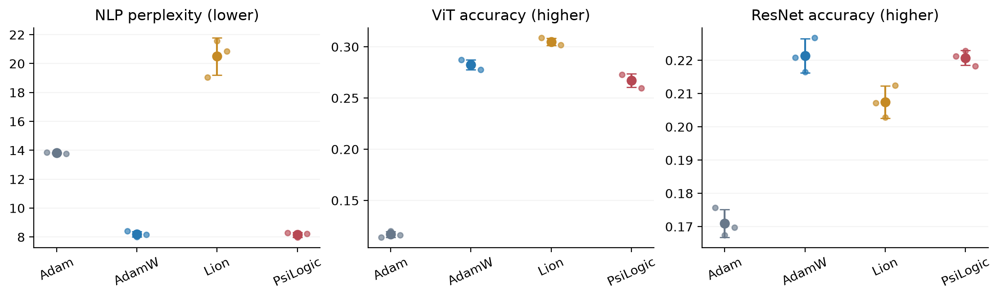
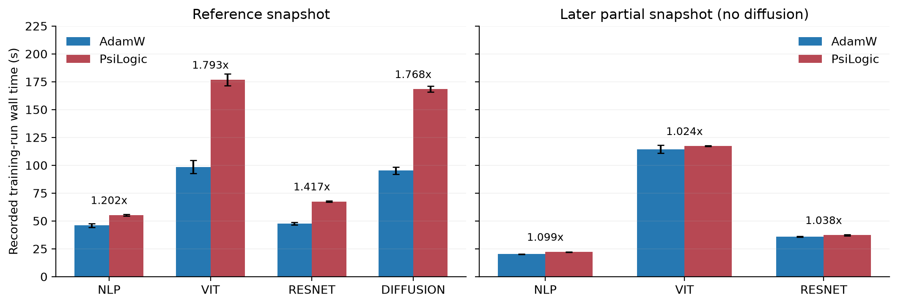
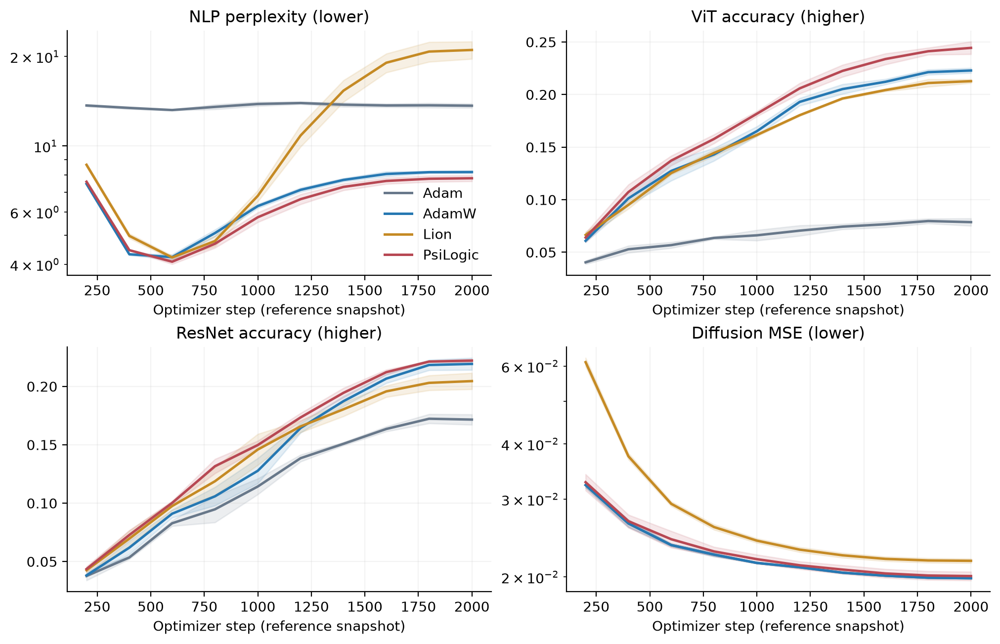

# PsiLogic: Chaos-Aware Active Cancellation for Adam with a Fair Cross-Domain Benchmark

**Ali Sultonov**  
Independent Researcher  
troxtergrif@gmail.com  
https://github.com/Troxter222/psilogic

**Original publication:** arXiv:2607.16268v1 [cs.LG], first submitted 5 July 2026. https://arxiv.org/pdf/2607.16268.

**Article DOI:** https://doi.org/10.48550/arXiv.2607.16268.

Local revision of the original preprint: implementation and empirical audit, revised 15 October 2026. Audited software version: 0.6.0.

## Abstract

PsiLogic multiplies an Adam-style update by a bounded, tensor-specific trust factor. The factor combines changes in a normalized gradient norm with disagreement between the current gradient and previous momentum. We state the equations implemented in the current source, including preprocessing, bias correction, epsilon placement, warmup, and optional update modes. Here, “chaos” names a gradient statistic; it is not a claim about mathematical chaos or a direct measurement of training instability.

We reassess two saved H100 benchmark snapshots. The four-task reference snapshot favors PsiLogic in mean NLP perplexity and ViT accuracy. The later partial snapshot gives a different picture: NLP perplexity is 8.15 ± 0.16 for PsiLogic and 8.20 ± 0.20 for AdamW; ViT accuracy is 26.72 ± 0.67% and 28.25 ± 0.47%; ResNet accuracy is 22.08 ± 0.23% and 22.14 ± 0.52%. Recorded run wall time in the later snapshot is 1.099×, 1.024×, and 1.038× AdamW, respectively. No later diffusion outcome is available. These are run-time ratios; a separate saved optimizer-only microbenchmark reports a fused-step ratio of 2.27× AdamW. The snapshots use different software versions and selected learning rates, so their difference does not isolate kernel fusion. We report seed-paired tests with an explicit Holm correction and retain the older results separately. No new training was performed for this revision. The evidence supports modest full-run overhead in the later workloads, but does not establish a general quality advantage over AdamW or validate every historical outcome for the current implementation.

## 1. Motivation and scope

Adam already adapts its update through running gradient moments [2]. PsiLogic asks a narrower question: can a small additional reduction of each tensor's update help when recent gradient statistics change or its gradient opposes accumulated momentum? It keeps Adam's coordinate-wise preconditioner and adds one scalar multiplier per tensor. Tensors can receive different damping even when they share a learning rate.

This motivation does not establish better training. A gradient opposing momentum may contain useful information, and damping it may slow progress. A sudden norm increase may also be meaningful rather than harmful. We treat the detector as a heuristic rather than calling it a reliable measure of confusion or convergence.

This manuscript revises the original PsiLogic preprint [1], first submitted to arXiv on 5 July 2026. The arXiv paper is the primary scholarly reference for PsiLogic. This local revision makes the current update explicit and reports what the saved measurements support, including unfavorable outcomes. These are distinct evidence: run metadata does not identify exact training commits or serialize every resolved optimizer setting. Equations describe the audited source; tables describe named CSV snapshots. We cannot certify that an archived run executed every equation of today's implementation.

## 2. Relation to existing optimizers

Adam maintains first and second moments and corrects their initialization bias [2]. AdamW separates parameter decay from the gradient direction [3]. PsiLogic follows that separation: ordinary decay acts on parameters, while cancellation scales the optimizer update. Optional Lion mode uses a sign-momentum direction [4] with the same trust factor. This is a tensor-level effective learning-rate adjustment, not a curvature estimate or replacement for an external schedule.

Gradient centralization and adaptive gradient clipping are optional preprocessing operations. They change the gradients used by both optimizer and detector. Results with these options enabled measure the full configuration and cannot isolate cancellation's contribution. We make no claim of priority over all gradient-dependent learning-rate methods and provide no convergence theorem.

## 3. The implemented algorithm

### 3.1 State and preprocessing

Let $i$ identify a tensor in parameter group $k$, and $n_i$ its number of elements. Its counter $t$ starts at 1 and advances only when that tensor has a gradient. A skipped tensor receives no moment, detector, or decay update. Thus $t$ need not equal the global step. Let $\eta_{k,t}$ be the trainer-supplied learning rate, $\lambda_k$ the decoupled decay coefficient, and $\epsilon$ the numerical stabilizer. We suppress group indices on other settings. Parameter-shaped products, squares, square roots, and divisions are elementwise.

Let $h_{i,t}$ be the gradient received by the optimizer, after trainer-side unscaling, accumulation, or global clipping. Tensor-wise adaptive gradient clipping (AGC) with coefficient $a>0$ gives

$$
\widetilde g_{i,t}=h_{i,t}\min\left(1,\frac{a\max(\|\theta_{i,t}\|_2,10^{-3})}{\max(\|h_{i,t}\|_2,10^{-6})}\right).
$$

For $a\leq0$, $\widetilde g=h$. Enabled gradient centralization, on tensors with more than one dimension, gives

$$
g_{i,t}=\widetilde g_{i,t}-\operatorname{mean}_{d=1,\ldots,D_i-1}(\widetilde g_{i,t}).
$$

Otherwise $g=\widetilde g$. Reduced dimensions remain for broadcasting; the first dimension is not averaged. Moments and detector use $g$. Secondary decay uses $\widetilde g$ before centralization. AGC reads parameters before decay. State is FP32 even with FP16/BF16 parameters. Equations specify arithmetic, not bitwise equality across devices or dtypes.

### 3.2 Normalized gradient statistics

The root-mean-square gradient magnitude is

$$
u_{i,t}=\frac{\|g_{i,t}\|_2}{\sqrt{\max(n_i,1)}}.
$$

Initialize $A_{i,1}=u_{i,1}$ and dimensionless averages $F_{i,1}=S_{i,1}=1$. For $t>1$,

$$
\begin{aligned}
A_{i,t}&=0.99A_{i,t-1}+0.01u_{i,t},\\
r_{i,t}&=u_{i,t}/(A_{i,t}+\epsilon),\\
F_{i,t}&=0.90F_{i,t-1}+0.10r_{i,t},\\
S_{i,t}&=0.99S_{i,t-1}+0.01r_{i,t}.
\end{aligned}
$$

The ratio uses newly updated $A$. Averages advance during warmup and with cancellation disabled. They track relative magnitude, not gradient variance. Normalization approximately removes constant gradient rescaling when epsilon is negligible; it is not exact scale invariance near numerical zero.

### 3.3 Continuous signal and trust

With momentum before the current update denoted by $m_{i,t-1}$, set disagreement $D_{i,1}=0$. Subsequently,

$$
\begin{aligned}
c_{i,t}&=\operatorname{clip}\left(\frac{\langle m_{i,t-1},g_{i,t}\rangle}{\|m_{i,t-1}\|_2\|g_{i,t}\|_2+\epsilon},-1,1\right),\\
D_{i,t}&=\tfrac12(1-c_{i,t}).
\end{aligned}
$$

Epsilon is inside the cosine denominator. After the first update, zero momentum or zero gradient gives $D=1/2$, not the first-step value. With $\sigma(x)=1/(1+e^{-x})$, adaptive scale $\tau_s$ and fixed setting $\tau_c$, define

$$
E_{i,t}=\begin{cases}
\sigma\left(\dfrac{4}{\max(\tau_s-1,0.25)}\left(\dfrac{F_{i,t}}{S_{i,t}+\epsilon}-1\right)\right),&\text{adaptive},\\
\sigma\left(4\left(\dfrac{S_{i,t}}{\max(\tau_c,\epsilon)}-1\right)\right),&\text{fixed}.
\end{cases}
$$

Fixed mode also uses normalized slow state, not a raw-norm threshold. When the cancellation path is active,

$$
C_{i,t}=\tanh(S_{i,t})\left(\tfrac12 E_{i,t}+\tfrac12 D_{i,t}\right).
$$

With warmup gain $w$, effective gamma $\gamma$, amplification $P_k$, and $b=\min(b_0,0.99)$,

$$
T_{i,t}=1-\min(C_{i,t}\gamma_{i,t}P_k w_{i,t},b).
$$

For intended nonnegative amplification, $1-b\leq T\leq1$. Default $b_0=0.05$ gives $T\geq0.95$. The code clamps cancellation only from above and does not reject negative amplification; these bounds assume $P_k\geq0$.

If gain or effective gamma is zero, the path is inactive: trust is 1 and the stored soft signal is zero. This is an inactive marker, not a measurement of quiet gradients. Equal fast and slow state does not close the gate: their ratio near 1 gives $E\approx1/2$. With $S\approx1$ and aligned gradients, $C\approx\tanh(1)/4\approx0.1904$. Gamma 0.05, amplification 1, and full gain then yield about 0.95% damping. Stable directions and small absolute gradients do not guarantee zero cancellation; a limit such as $S\to0$ does force the active signal to zero.

### 3.4 Schedules and warmup

For configured horizon $H$, the common gamma and secondary-decay schedule is

$$
z_t=\begin{cases}\tfrac12[1+\cos(\pi\min(t/H,1))],&H>0,\\1,&H=0.\end{cases}
$$

Set $\gamma_t^{\rm sched}=\gamma_0z_t$ and $q_t=q_0z_t$. Optional automatic gamma multiplies scheduled gamma by $\max(S_{i,t}/0.1,0.1)$ when $t>1$ and $S_{i,t}<0.1$, and leaves it unchanged otherwise. This option is off by default and is not a convergence test.

Automatic chaos warmup gives $W=\max(500,\lfloor H/20\rfloor)$ for $H>0$, or 200 for $H=0$. An explicitly supplied nonnegative length overrides it. With $R=\max(1,\lfloor W/4\rfloor)$,

$$
w_{i,t}=\begin{cases}0,&t\leq W,\\\min(1,(t-W)/R),&t>W.\end{cases}
$$

Warmup zero activates the path on the first update. The bare constructor with unknown horizon waits 200 updates, then ramps for 50. This is separate from trainer LR warmup. Each tensor's counter drives both internal schedules.

### 3.5 Adam update, epsilon, and decay

Starting with $m_{i,0}=v_{i,0}=0$,

$$
\begin{aligned}
m_{i,t}&=\beta_1m_{i,t-1}+(1-\beta_1)g_{i,t},\\
v_{i,t}&=\beta_2v_{i,t-1}+(1-\beta_2)g_{i,t}^{\odot2}.
\end{aligned}
$$

Ordinary decay multiplies parameters by $1-\eta_{k,t}\lambda_k$. If $q_t>0$ and cancellation is active ($w>0$, $\gamma>0$), secondary decay adds

$$
\rho_{i,t}=1-\eta_{k,t}q_tw_{i,t}(1-C_{i,t})\tanh(|\widetilde g_{i,t}|).
$$

Otherwise $\rho=1$. The API calls this option quantum_decay; it has no quantum-mechanical interpretation and is disabled by default. Both decay factors act before the optimizer direction:

$$
\boxed{\theta_{i,t+1}=\rho_{i,t}(1-\eta_{k,t}\lambda_k)\theta_{i,t}
-\eta_{k,t}\frac{\sqrt{1-\beta_2^t}}{1-\beta_1^t}\,T_{i,t}\frac{m_{i,t}}{\sqrt{v_{i,t}}+\epsilon}.}
$$

With bias-corrected moments $\widehat m=m/(1-\beta_1^t)$ and $\widehat v=v/(1-\beta_2^t)$, the direction is

$$
\frac{T_{i,t}\widehat m_{i,t}}{\sqrt{\widehat v_{i,t}}+\epsilon/\sqrt{1-\beta_2^t}}.
$$

Replacing that denominator with $\sqrt{\widehat v}+\epsilon$ changes the algorithm. For $\beta_2=0.999$, first-update effective epsilon is about $31.62\epsilon$. With all extras disabled, this is AdamW-style arithmetic with that convention, not exact algebraic identity to usual PyTorch AdamW. Tolerance-based equivalence checks do not prove exact equality.

### 3.6 Lion and distributed execution

Optional Lion mode gives

$$
\begin{aligned}
d_{i,t}&=\operatorname{sign}(\beta_1m_{i,t-1}+(1-\beta_1)g_{i,t}),\\
\theta_{i,t+1}&=\rho_{i,t}(1-\eta_{k,t}\lambda_k)\theta_{i,t}-\eta_{k,t}T_{i,t}d_{i,t},\\
m_{i,t}&=\beta_2m_{i,t-1}+(1-\beta_2)g_{i,t}.
\end{aligned}
$$

Disagreement still uses previous momentum. Lion has no Adam bias correction. The shared initializer allocates a second-moment buffer, but it does not enter this update.

Optional distributed detector synchronization averages $F,S$ across ranks after their local update and before computing the signal. It does not explicitly synchronize $A$ or disagreement. Averaging $F,S$ cannot guarantee identical trust if ranks differ in gradients, momentum, counters, or settings. Ordinary DDP with matching reduced gradients and state is the intended setting.

### 3.7 Execution order, defaults, and source map

1. Skip tensors without gradients; apply optional AGC, then centralization.
2. Increment active tensor counters; when cancellation can activate, compute disagreement against previous momentum.
3. Update Adam moments in Adam mode and norm averages in both modes.
4. Optionally average fast/slow state across distributed ranks.
5. Resolve effective gamma, signal, and trust. Apply ordinary decay, then active secondary decay.
6. Apply the direction; update Lion momentum after constructing its direction.

Bare defaults are LR 0.001, betas (0.9, 0.999), decay 0.0001, epsilon 1e-8, gamma 0.05, amplification 1, cap 0.05, adaptive thresholding, tau scale 2, and automatic chaos warmup. AGC, centralization, secondary decay, automatic gamma, Lion, and detector synchronization are off. CUDA foreach and fused execution are requested by default with availability-dependent fallback. CPU and compilation use the scalar implementation. Presets and parameter groups can override these settings.

API mapping: $A,F,S$ are gn_avg, fast, slow; $C$ is soft_chaos; $P_k$ is p_ext; $b_0$ is max_cancel; $\tau_s,\tau_c$ are tau_scale, chaos_tau; $H$ is gamma_T_max; $q_0$ is quantum_decay; $a$ is agc_clip. Preprocessing and update order are in psilogic/optimizer.py; detector helpers in psilogic/_chaos.py; accelerated execution in psilogic/_cuda/step.py and kernels.py. Backends target the same rule, with possible precision and reduction-order differences. Software checks cannot establish which source a historical run executed.

## 4. Evidence and protocol

### 4.1 Snapshots and provenance

The reference is benchmark/results/full; the later partial snapshot is benchmark/results/fused_h100. Means and sample SD are recalculated from summaries and checked against aggregate CSVs. Each reported combination has successful runs for seeds 0, 1, and 2. The later summary has only NLP, ViT, and ResNet, although its configuration requests diffusion. A requested task without outcomes is not a completed experiment.

Both configs specify H100 80GB HBM3, batch 64, BF16 AMP, global clipping at 1, cosine LR with 100 warmup steps, seven log-spaced LR candidates from 1e-5 to 1e-2, sweep limits of 500 steps or 5 epochs, and evaluation limits of 2000 steps or 10 epochs. The loop stops at the applicable step or epoch limit. These are configured budgets: absent later step histories, we cannot confirm every later run completed 2000 updates.

Arena definitions describe a small GPT on TinyStories, ViT on CIFAR-100, ResNet-18 on Tiny ImageNet, and DDPM/UNet diffusion on CelebA. Metadata does not fully serialize historical architecture, transforms, or resolved optimizer arguments. ViT also has a package-dependent model fallback; future runs should record the actual architecture.

The reference environment is PyTorch 2.4.1+cu124/CUDA 12.4; the later environment is 2.8.0+cu128/CUDA 12.8. Later ViT peak allocation is about 5497 MiB for PsiLogic, compared with roughly 1229 MiB in the reference. These changes and different selected rates prevent a controlled backend-only comparison. The later directory name indicates a fusion evaluation, but the config lacks per-run backend records. We report outcomes, not a verified kernel trace.

### 4.2 Statistics

For this audit, we select one primary outcome per arena: NLP perplexity, vision accuracy, and diffusion MSE. NLP learning-rate selection in the harness uses validation loss; exponentiating loss preserves outcome ordering but does not preserve the paired t-test statistic. Two-sided seed-paired tests compare the audit's selected outcomes. Holm correction covers all arena-by-baseline primary comparisons within each snapshot: 12 reference tests and 9 later tests. This family differs from the reference's saved unpaired Welch tests and the later saved analyzer's per-arena, multiple-metric family. Original significance files remain unchanged; new results are written separately.

Tables give raw and adjusted p-values. Three pairs leave two degrees of freedom, and normality of differences cannot be meaningfully assessed. This retrospective analysis was not preregistered. Failure to reject does not establish equivalence; significance does not establish usefulness. Pairing assumes matching seed labels represent matched conditions, as intended by the harness. CSVs alone cannot verify initialization or data order.

### 4.3 Timing definition

Saved final wall time covers the training loop, periodic evaluation, and final evaluation. It excludes preparation, LR selection, and model/optimizer construction. The current harness synchronizes step timing; exact historical behavior needs the missing source revisions. Ratios divide mean run times, not optimizer-only times or individual seed ratios. The optional optimizer host profiler is asynchronous on CUDA and cannot replace synchronized GPU measurements. No time-to-target-quality claim is made.

## 5. Later partial results

### 5.1 Quality

Table 1. Later primary metrics, mean ± sample SD over three seeds. Accuracy is a fraction. Bold marks the best observed mean, not significance.

<!-- BEGIN GENERATED: later_quality -->
| Primary metric | Adam | AdamW | Lion | PsiLogic |
| --- | --- | --- | --- | --- |
| NLP perplexity (lower) | 13.81 ± 0.06 | 8.20 ± 0.20 | 20.50 ± 1.29 | **8.15 ± 0.16** |
| ViT accuracy (higher) | 0.1169 ± 0.0030 | 0.2825 ± 0.0047 | **0.3049 ± 0.0036** | 0.2672 ± 0.0067 |
| ResNet accuracy (higher) | 0.1710 ± 0.0042 | **0.2214 ± 0.0052** | 0.2075 ± 0.0049 | 0.2208 ± 0.0023 |
<!-- END GENERATED: later_quality -->

Table 2. Validation losses from the same later runs, descriptive secondary outcomes.

<!-- BEGIN GENERATED: later_loss -->
| Validation loss | Adam | AdamW | Lion | PsiLogic |
| --- | --- | --- | --- | --- |
| NLP | 2.626 ± 0.004 | 2.104 ± 0.024 | 3.019 ± 0.064 | 2.098 ± 0.020 |
| VIT | 3.880 ± 0.002 | 2.886 ± 0.013 | 2.764 ± 0.011 | 2.973 ± 0.017 |
| RESNET | 3.813 ± 0.009 | 3.456 ± 0.009 | 3.509 ± 0.023 | 3.467 ± 0.008 |
<!-- END GENERATED: later_loss -->

The NLP mean is about 0.6% below AdamW, much smaller than the reference gap of about 4.7%; the later paired test does not detect an advantage. ViT trails AdamW by about 1.54 percentage points and Lion by about 3.77. ResNet differs from AdamW by about -0.06 points. After the nine-test Holm correction, the ViT loss against AdamW remains detectable (adjusted p = 0.0294), whereas NLP and ResNet differences do not. The later timing results cannot be presented as preserving the earlier ViT advantage.

### 5.2 Wall time and memory

Table 3. Later run wall time in seconds, mean ± sample SD; final column is ratio of means.

<!-- BEGIN GENERATED: later_time -->
| Arena | Adam | AdamW | Lion | PsiLogic | Psi/AdamW |
| --- | --- | --- | --- | --- | --- |
| NLP | 20.49 ± 0.17 | 20.22 ± 0.07 | 19.90 ± 0.07 | 22.22 ± 0.18 | 1.099× |
| VIT | 113.58 ± 1.90 | 114.45 ± 3.76 | 112.69 ± 1.88 | 117.18 ± 0.34 | 1.024× |
| RESNET | 36.08 ± 0.49 | 35.87 ± 0.38 | 35.34 ± 0.18 | 37.25 ± 0.72 | 1.038× |
<!-- END GENERATED: later_time -->

Overhead relative to AdamW is about 9.9% for NLP, 2.4% for ViT, and 3.8% for ResNet. This supports modest end-to-end overhead in these recorded workloads. It does not show PsiLogic is faster than AdamW, quantify optimizer-only overhead, or isolate fusion's contribution.

Table 4. Peak allocated GPU memory in MiB (bytes divided by 1024 squared), mean ± sample SD. This is not total board usage or reserved memory.

<!-- BEGIN GENERATED: later_memory -->
| Peak allocated MiB | Adam | AdamW | Lion | PsiLogic |
| --- | --- | --- | --- | --- |
| NLP | 458.4 ± 0.1 | 458.4 ± 0.1 | 446.0 ± 0.1 | 458.6 ± 0.1 |
| VIT | 5491.9 ± 5.4 | 5492.6 ± 3.3 | 5164.4 ± 5.3 | 5497.2 ± 4.2 |
| RESNET | 857.3 ± 0.4 | 855.6 ± 0.4 | 812.7 ± 0.4 | 857.8 ± 0.4 |
<!-- END GENERATED: later_memory -->

Within later arenas, PsiLogic and AdamW have similar allocations. Lion uses less memory. There is no demonstrated memory advantage for PsiLogic; the large cross-snapshot ViT memory change is unexplained by saved metadata.

### 5.3 Paired comparisons and rates

The saved optimizer-only profile gives a different cost picture. Its CUDA workload has 202,506 parameters in 50 tensors. The accompanying profiling script compares against foreach AdamW. The saved file reports one median per method, without repeated-run uncertainty or raw timing samples:

<!-- BEGIN GENERATED: later_profile -->
| Method | Saved median step (ms) | Ratio to AdamW |
| --- | --- | --- |
| AdamW | 0.603 | 1.00× |
| PsiLogic (foreach) | 4.986 | 8.27× |
| PsiLogic (fused) | 1.371 | 2.27× |
<!-- END GENERATED: later_profile -->

Fusion is much faster than PsiLogic's foreach path on this small workload, but the fused step is still about 2.27 times the AdamW step. That is compatible with a small full-training overhead when forward/backward work dominates, although this separate microbenchmark does not establish the optimizer's share of the three arena runtimes. The saved run note is dated 24 September 2026. Its availability check for Triton supports the intended fused evaluation, but does not replace per-run backend traces or provide a matched comparison with the older environment.

Table 5. Later primary-quality tests, raw p / Holm-adjusted p, across nine comparisons. Direction follows Table 1.

<!-- BEGIN GENERATED: later_stats -->
| Arena | vs Adam raw / Holm | vs AdamW raw / Holm | vs Lion raw / Holm |
| --- | --- | --- | --- |
| NLP | 0.000275 / 0.00248 | 0.443 / 0.886 | 0.00446 / 0.0235 |
| VIT | 0.000882 / 0.00706 | 0.00735 / 0.0294 | 0.00338 / 0.0235 |
| RESNET | 0.00336 / 0.0235 | 0.902 / 0.902 | 0.0843 / 0.253 |
<!-- END GENERATED: later_stats -->

Table 6. Later selected base learning rates.

<!-- BEGIN GENERATED: later_lr -->
| Arena | Adam | AdamW | Lion | PsiLogic |
| --- | --- | --- | --- | --- |
| NLP | 0.000316 | 0.000316 | 0.000316 | 0.000316 |
| VIT | 3.16e-05 | 3.16e-05 | 1e-05 | 3.16e-05 |
| RESNET | 0.0001 | 0.000316 | 0.0001 | 0.000316 |
<!-- END GENERATED: later_lr -->

## 6. Historical reference outcomes

These four-arena results are the reference experiment reported in the original arXiv preprint [1]. They are retained here with recalculated statistics, separately from the quality associated with later timing.

Table 7. Reference primary metrics, mean ± sample SD; bold is best mean.

<!-- BEGIN GENERATED: reference_quality -->
| Primary metric | Adam | AdamW | Lion | PsiLogic |
| --- | --- | --- | --- | --- |
| NLP perplexity (lower) | 13.66 ± 0.22 | 8.17 ± 0.08 | 21.04 ± 1.41 | **7.79 ± 0.18** |
| ViT accuracy (higher) | 0.0787 ± 0.0035 | 0.2229 ± 0.0024 | 0.2127 ± 0.0018 | **0.2444 ± 0.0060** |
| ResNet accuracy (higher) | 0.1716 ± 0.0044 | 0.2192 ± 0.0052 | 0.2045 ± 0.0070 | **0.2221 ± 0.0014** |
| Diffusion MSE (lower) | **0.01987 ± 0.00006** | 0.01987 ± 0.00006 | 0.02175 ± 0.00025 | 0.02009 ± 0.00045 |
<!-- END GENERATED: reference_quality -->

Table 8. Recalculated reference tests, raw p / adjusted p across 12 comparisons.

<!-- BEGIN GENERATED: reference_stats -->
| Arena | vs Adam raw / Holm | vs AdamW raw / Holm | vs Lion raw / Holm |
| --- | --- | --- | --- |
| NLP | 0.000823 / 0.00906 | 0.0255 / 0.153 | 0.00394 / 0.0394 |
| VIT | 0.000518 / 0.00622 | 0.0465 / 0.232 | 0.0174 / 0.122 |
| RESNET | 0.00439 / 0.0395 | 0.512 / 1 | 0.0586 / 0.235 |
| DIFFUSION | 0.435 / 1 | 0.435 / 1 | 0.00503 / 0.0403 |
<!-- END GENERATED: reference_stats -->

These replace the old unadjusted Welch significance claims. Mean ordering is unchanged; inference must follow the recalculated tests rather than old stars. Reference means favor PsiLogic in NLP and ViT, give a small ResNet difference from AdamW, and slightly worse diffusion MSE than Adam/AdamW. None of the four primary comparisons against AdamW meets the adjusted 0.05 threshold: adjusted p is 0.153 for NLP, 0.232 for ViT, and 1 for ResNet and diffusion. These data therefore do not establish a corrected quality advantage over AdamW, including on diffusion.

Table 9. Reference run wall time in seconds and ratio of means.

<!-- BEGIN GENERATED: reference_time -->
| Arena | Adam | AdamW | Lion | PsiLogic | Psi/AdamW |
| --- | --- | --- | --- | --- | --- |
| NLP | 46.56 ± 1.38 | 45.94 ± 1.59 | 38.19 ± 7.36 | 55.23 ± 0.83 | 1.202× |
| VIT | 95.18 ± 8.85 | 98.54 ± 5.89 | 98.57 ± 5.59 | 176.73 ± 5.36 | 1.793× |
| RESNET | 45.26 ± 1.09 | 47.59 ± 1.27 | 46.13 ± 1.46 | 67.44 ± 0.64 | 1.417× |
| DIFFUSION | 94.21 ± 0.95 | 95.20 ± 3.27 | 91.62 ± 1.67 | 168.32 ± 2.59 | 1.768× |
<!-- END GENERATED: reference_time -->

Reference ratios are about 1.20×, 1.79×, 1.42×, and 1.77× for NLP, ViT, ResNet, and diffusion. They describe that environment, not later partial measurements. The difference documents an observed cost change without attributing all of it to fusion.

## 7. Discussion and limitations

The clearest engineering observation is smaller relative full-run overhead in the later snapshot. This coexists with a 2.27-fold optimizer-step cost in the separate saved microbenchmark; the two measurements answer different questions. Quality is less consistent: the older NLP and ViT advantages are not both present later. Software, selected rates, unrecorded architecture/configuration details, and possible implementation changes remain candidate explanations. Measurements do not isolate these factors or separate cancellation from preprocessing and presets.

Other exploratory NLP follow-ups and older experiments exist. We do not pool them because their settings differ. This is a retrospective report in a project with multiple experiments, not preregistered confirmation. Unit tests establish software properties under tested conditions, not better generalization.

Evidence is limited to three seeds per combination, small models, and short configured budgets. There is no later diffusion outcome, later step history, matched time-to-quality analysis, external replication established by these artifacts, or convergence proof. Exact training commits, resolved settings, and backend traces are absent. Validation used for LR selection is not an untouched test set. Equal LR candidate counts do not equalize all search effort.

The detector measures relative norm changes and disagreement, not curvature, noise variance, or proof a step is harmful. Its baseline sigmoid value allows damping under steady gradients. Small gradients do not guarantee zero damping. Secondary decay is separate, and epsilon placement makes the zero-cancellation limit different from standard AdamW.

A controlled follow-up should pin code, architecture, data processing, effective batch, precision, and environment; record resolved arguments and backend; compare execution paths under matching settings; and repeat all four tasks with more seeds. Ablations should separately disable cancellation, preprocessing, and secondary decay. Fixed-step quality and time to a prespecified target should both be reported, including unsuccessful runs. These are proposed experiments, not completed evidence.

## 8. Reproducing this revision

PAPER.md is the source for generated LaTeX and PDF. Tables, figures, paired tests, and file hashes are derived from saved measurements:

~~~bash
python scripts/paper_results.py
python scripts/build_arxiv_pdf.py
~~~

Analysis requires NumPy, SciPy, and Matplotlib; PDF compilation requires pdflatex or the repository's Tectonic executable. Canonical output is output/pdf/paper.pdf, with copies at arxiv/paper.pdf and psilogic-arxiv.pdf. Analysis and provenance hashes are in arxiv/generated. Hashes identify analyzed files, not unknown training revisions. Source CSVs remain unchanged. No training or downloads occur during this analysis.

For scholarly citation of PsiLogic, use the original arXiv preprint [1]: arXiv:2607.16268, https://arxiv.org/pdf/2607.16268, article DOI https://doi.org/10.48550/arXiv.2607.16268. The Zenodo software record [5] is a supplementary reference for code and artifacts. The revised equations and reanalysis in this local manuscript are dated separately from the original arXiv version.

To evaluate the current update, install benchmark dependencies and prepare datasets as documented in benchmark/README.md. Record the source revision and resolved arguments before starting:

~~~bash
pip install -e ".[benchmark,cuda]"
pip install -r benchmark/requirements.txt
cd benchmark
python -m fairbench --data-root ./data --output-dir results/current_rerun
~~~

This starts a current-default experiment, not a reconstruction of unspecified historical settings. The same optimizer name alone does not make an older table reproducible.

## 9. Conclusion

PsiLogic adds bounded tensor-wise damping around an Adam-style direction, with optional preprocessing, secondary decay, and Lion mode. The equations include details that change its mathematics. Later H100 measurements show 2.4-9.9% additional recorded run time relative to AdamW across three tasks, near-AdamW NLP and ResNet means, and worse ViT accuracy. The separate optimizer-only microbenchmark still costs 2.27× AdamW for fused PsiLogic. Older four-task outcomes remain separate. These findings justify controlled evaluation, not a universal quality claim or a claim that historical tables validate every detail of today's code.

## References

[1] A. Sultonov. PsiLogic: Chaos-Aware Active Cancellation for Adam with a Fair Cross-Domain Benchmark. arXiv:2607.16268v1 [cs.LG], 5 July 2026. https://arxiv.org/pdf/2607.16268. Article DOI: https://doi.org/10.48550/arXiv.2607.16268. Original paper and primary scholarly reference.

[2] D. P. Kingma and J. Ba. Adam: A Method for Stochastic Optimization. ICLR, 2015. https://arxiv.org/abs/1412.6980.

[3] I. Loshchilov and F. Hutter. Decoupled Weight Decay Regularization. ICLR, 2019. https://arxiv.org/abs/1711.05101.

[4] X. Chen et al. Symbolic Discovery of Optimization Algorithms. NeurIPS, 2023. https://arxiv.org/abs/2302.06675.

[5] A. Sultonov. PsiLogic software and FairBench artifacts. Supplementary software record: https://doi.org/10.5281/zenodo.18739857. Numerical sources for this local revision are the snapshots identified in Section 4.

## Appendix A. Later per-seed primary outcomes

Accuracy is a fraction; tests use seed values before rounding.

<!-- BEGIN GENERATED: later_seeds -->
| Arena / seed | Adam | AdamW | Lion | PsiLogic |
| --- | --- | --- | --- | --- |
| NLP / 0 | 13.86950 | 8.40920 | 19.05928 | 8.27578 |
| NLP / 1 | 13.81303 | 8.02130 | 21.56638 | 7.96639 |
| NLP / 2 | 13.75750 | 8.17168 | 20.86497 | 8.21472 |
| VIT / 0 | 0.11420 | 0.28720 | 0.30890 | 0.27290 |
| VIT / 1 | 0.12020 | 0.28260 | 0.30390 | 0.26880 |
| VIT / 2 | 0.11630 | 0.27780 | 0.30190 | 0.25980 |
| RESNET / 0 | 0.17570 | 0.22080 | 0.20720 | 0.22120 |
| RESNET / 1 | 0.16750 | 0.21650 | 0.20280 | 0.22280 |
| RESNET / 2 | 0.16970 | 0.22680 | 0.21250 | 0.21830 |
<!-- END GENERATED: later_seeds -->

## Appendix B. Reference selected rates

<!-- BEGIN GENERATED: reference_lr -->
| Arena | Adam | AdamW | Lion | PsiLogic |
| --- | --- | --- | --- | --- |
| NLP | 0.000316 | 0.000316 | 0.000316 | 0.000316 |
| VIT | 3.16e-05 | 0.000316 | 0.0001 | 0.000316 |
| RESNET | 0.0001 | 0.000316 | 0.0001 | 0.000316 |
| DIFFUSION | 0.001 | 0.001 | 0.0001 | 0.001 |
<!-- END GENERATED: reference_lr -->

## Appendix C. Reference per-seed primary outcomes

<!-- BEGIN GENERATED: reference_seeds -->
| Arena / seed | Adam | AdamW | Lion | PsiLogic |
| --- | --- | --- | --- | --- |
| NLP / 0 | 13.89225 | 8.18040 | 19.46536 | 7.87066 |
| NLP / 1 | 13.64020 | 8.09092 | 21.46757 | 7.58325 |
| NLP / 2 | 13.44957 | 8.24811 | 22.18221 | 7.91506 |
| VIT / 0 | 0.07750 | 0.22550 | 0.21440 | 0.23760 |
| VIT / 1 | 0.08260 | 0.22220 | 0.21080 | 0.24680 |
| VIT / 2 | 0.07590 | 0.22090 | 0.21300 | 0.24880 |
| RESNET / 0 | 0.17510 | 0.21940 | 0.20240 | 0.22090 |
| RESNET / 1 | 0.16660 | 0.21400 | 0.19890 | 0.22360 |
| RESNET / 2 | 0.17300 | 0.22430 | 0.21230 | 0.22170 |
| DIFFUSION / 0 | 0.01985 | 0.01985 | 0.02169 | 0.02004 |
| DIFFUSION / 1 | 0.01982 | 0.01982 | 0.02153 | 0.01967 |
| DIFFUSION / 2 | 0.01993 | 0.01993 | 0.02202 | 0.02057 |
<!-- END GENERATED: reference_seeds -->
